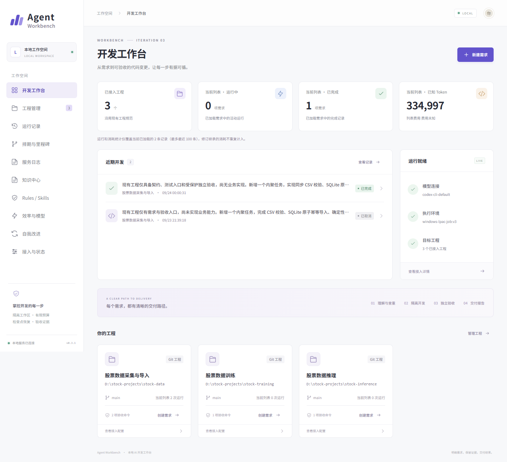
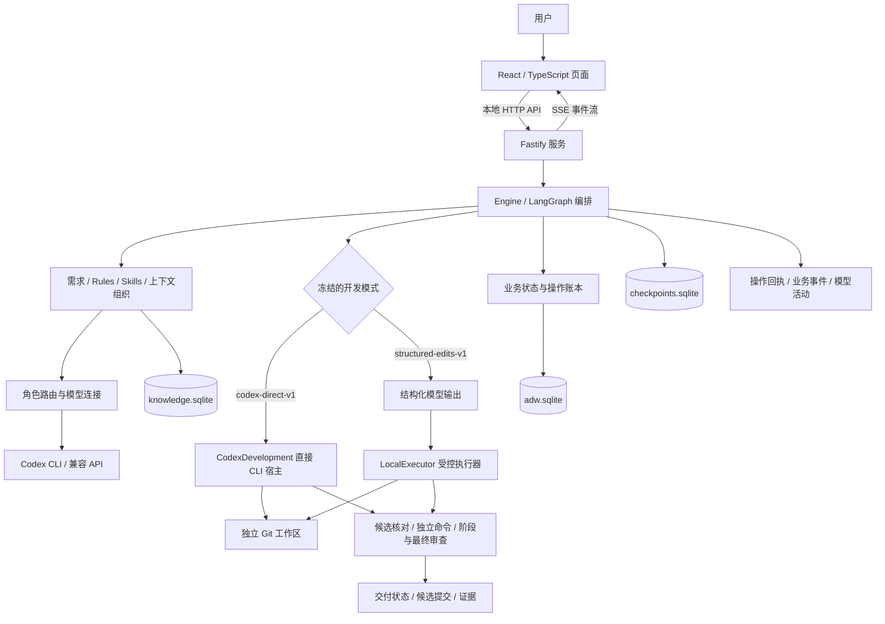
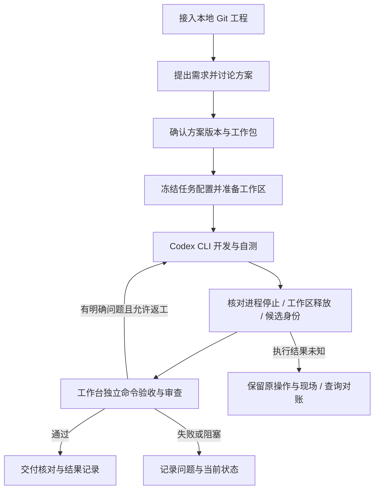
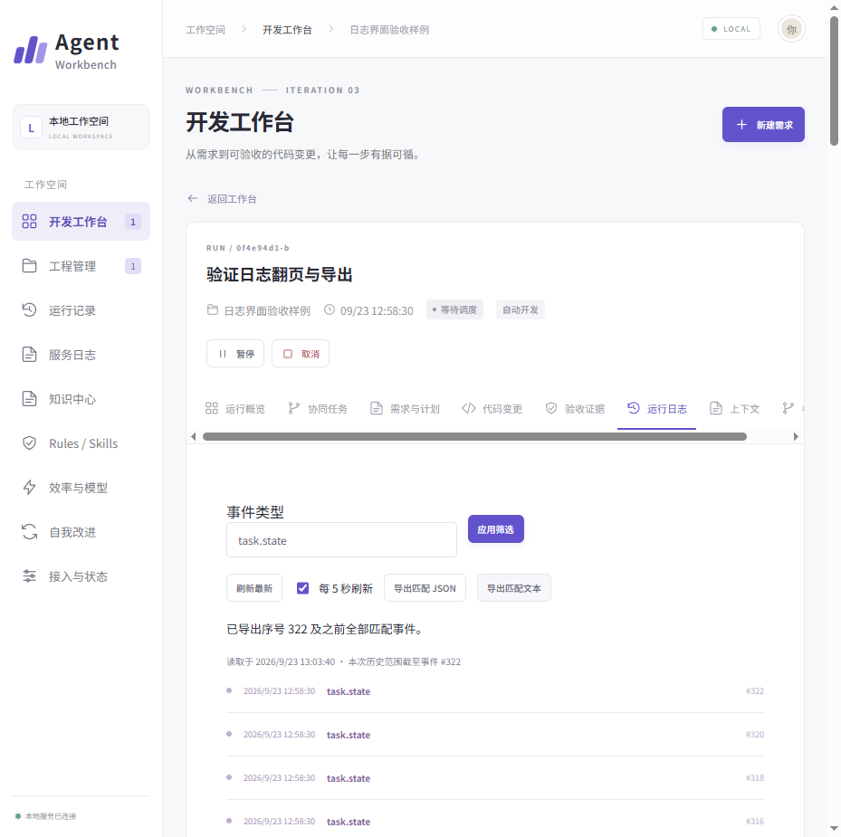
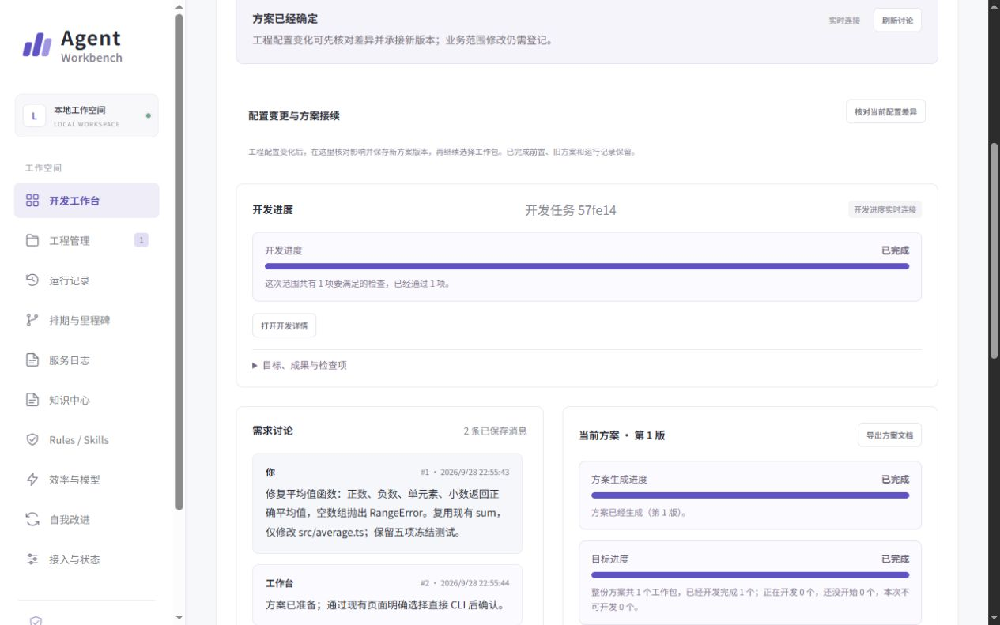
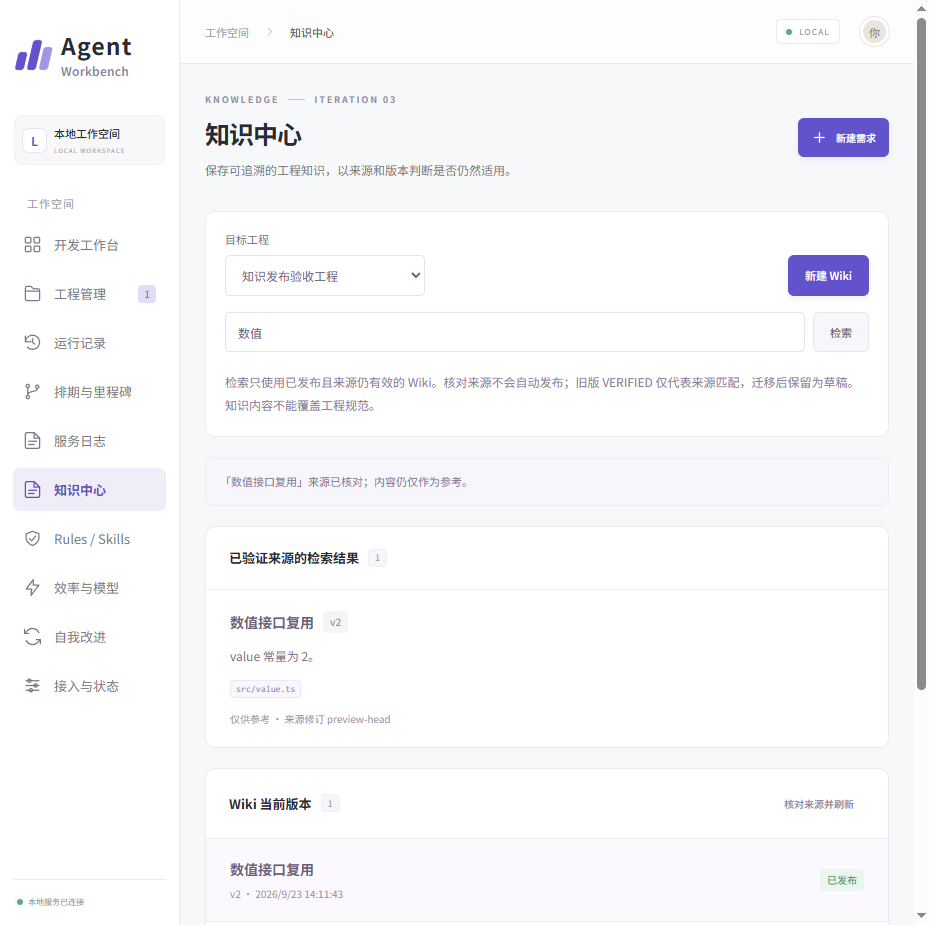
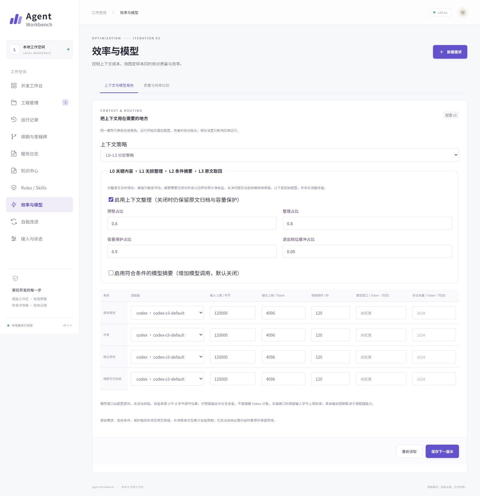

# Agent Workbench

**Windows 本地可视化 AI 开发工作台：从需求讨论、方案确认，到 AI 开发、独立验收与交付追踪。**

Agent Workbench 将浏览器中的需求管理与本地 Git 工程连接起来，让开发过程中的方案、代码变更、运行日志、验收证据和交付结果可以在同一处查看。

项目采用 React、TypeScript、Fastify、LangGraph 和 SQLite。已记录的正式部署为新普通任务启用了 Codex CLI 直接开发：CLI 在独立 Git 工作区内读取、修改代码并执行自测，工作台随后核对候选，组织独立命令验收及审查。原有结构化输出与受控执行器路径继续保留。

> 当前版本：`0.3.1`，持续开发中。面向 Windows 原生环境和 TypeScript / Node.js 被管理工程。直接 CLI 路径按当前 Windows 账户权限运行，**没有操作系统级执行隔离**；独立工作区、Git 和变更核对用于管理成果。



*历史正式服务截图，来自 2026-09-24 的只读页面检查。工程数量、运行状态和配置状态均属于当时现场。*

## 为什么做这个项目

在命令行中调用 AI 编码只是开发流程的一部分。接入真实工程后，还需要明确需求与写入范围，关联方案和开发任务，判断模型是否真正停止，以及用独立证据核对交付结果。

本项目将这些环节组织为一条可追踪的流程：

- **需求可确认**：讨论保留方案版本，确认工作包后进入开发。
- **过程可观察**：查看任务进度、操作事件、失败记录、模型活动与已知用量。
- **结果可核对**：将 CLI 自测、工作台独立验收、候选提交和最终状态分别记录。
- **异常可追溯**：操作意图、回执和检查点分开持久化，保留原失败与未知结果。

## 核心功能

| 功能 | 已有实现与用途 |
| --- | --- |
| 工程接入 | 登记本地 Git 工程、基线、验收命令及任务范围 |
| 需求讨论与方案确认 | 保存需求与方案版本，展示工作包并关联后继开发任务 |
| Codex CLI 直接开发 | 在独立工作区完成代码读取、修改与自测，收集活动及候选证据 |
| 独立验收与交付 | 在 CLI 自测之外执行验收命令与审查，核对候选及交付状态 |
| 运行控制与恢复核对 | 提供暂停、取消、继续和回执核对；结果未知时保留原操作身份 |
| 日志与成果统计 | 区分业务事件与服务日志，支持筛选、导出及已知用量统计 |
| 知识与上下文 | 管理来源、Wiki、Rules / Skills 版本及运行固定的上下文资产 |

上表描述已有功能入口；实际可用范围取决于工程配置、执行模式和对应验收证据。

## 系统架构



浏览器通过本地 API 操作服务，SQLite 与工程文件由服务端管理。两条开发路径具有不同执行边界，不能将旧执行器的隔离能力套用到直接 CLI 路径。

### 两种开发模式

| 模式 | 工作方式 | 关键边界 |
| --- | --- | --- |
| `codex-direct-v1` | Codex CLI 自主读取、修改和自测，工作台收集回执并核对候选 | 需显式启用；当前串行执行；没有 OS 权限隔离 |
| `structured-edits-v1` | 模型产生结构化结果，工作台校验并通过执行器应用变更、执行命令 | 保留原路径；能力依赖实际执行器配置与本机隔离检查 |

正式部署记录已为新普通任务选择直接 CLI；**源码未配置时仍默认 `structured-edits-v1`，且直接开发宿主默认关闭**。配置变更不会自动迁移已冻结的历史任务。

## 从需求到交付



CLI 自测通过后，仍需通过工作台的独立验收与最终交付核对。这里的“交付”指被管理工程的候选成果与回执，不自动授予外部推送、合并或生产发布权限。

## 工程设计

### 业务状态、操作回执与图检查点分离

`adw.sqlite` 保存工程、运行、操作、事件、预算预留和租约等业务事实；`checkpoints.sqlite` 保存 LangGraph 的编排位置。执行副作用前先持久化操作意图，取得回执后再推进状态与检查点，避免把流程走到哪一步当成操作已经成功。

### 围绕同一操作恢复

操作通过稳定身份关联意图、进程与回执。网络断开、宿主退出或结果未知时，先核对原操作与真实进程身份；不会仅因租约到期就认定原执行已经停止。已有成果和失败记录保留，重启不重置累计用量。

### 自测与独立验收分开

开发 CLI 的测试输出作为开发证据保留。工作台另行执行验收命令与审查，并将结果绑定到对应候选，避免将开发者的完成声明直接当作交付结论。

### 保留失败与未知值

业务日志与服务诊断分开；失败、返工和恢复可沿运行与操作关联。缺失 Token、费用或归因数据时保留未知，不填零，也不从单个成功案例推导整体成功率或效率收益。

## 界面展示

以下均为已保存的历史截图，不代表本次重新运行了模型或业务任务。不同任务、版本和验收样例已在图注中区分。

### 需求方案与工作包确认


*CE-08/09 中位数函数案例：确认需求、验收条件、工作包和直接 CLI 模式。*

### 真实开发完成与交付状态


*CE-08/09 同一案例的历史完成页。原记录包含一次真实 CLI 开发，工作台独立命令 6/6 通过，以及阶段、最终审查通过；详情摘要中的旧文案需结合结构化状态、验收和候选记录阅读。*

### 自测证据与失败记录


*来自另一组 CE-02/04/05 平均值函数案例。失败和成功回执均保留；图中的 CLI 自测回执不等于工作台独立验收。*

### 运行日志筛选与导出



*历史 S17 日志界面验收样例，展示筛选与导出能力；图中样例数量不代表实际生产负载。*

<details>
<summary>查看其余 7 张截图</summary>

#### 工程管理与接入列表


*CE-08/09 历史工程登记页面，包含业务工程和验收工程。*

#### 需求讨论与开发进度



*CE-02/04/05 历史平均值案例，展示讨论任务与后继开发任务关联。*

#### 服务日志与错误筛选


*S17 历史界面验收样例，错误行属于样例数据。*

#### 知识中心与来源核对



*S16 历史知识功能验收样例；该样例未调用真实模型，不作为业务检索效果评测。*

#### 上下文策略与模型角色配置



*2026-09-24 正式服务只读截图，阈值和容量属于当时配置。*

#### 运行上下文与原文回读


*历史模拟数据界面，页面保留模拟标识；材料字节变化不等于实测 Token 节省。*

#### 开发完成与交付回执完整页


*与前面的中位数完成页为同一次运行，长图用于补充查看回执，不另算一个成功案例。*

</details>

## 技术栈

| 层次 | 技术与用途 |
| --- | --- |
| 前端 | React、TypeScript、Vite |
| 服务端 | Node.js 24+、Fastify、本地 HTTP API、SSE |
| 编排 | LangGraph，承载运行流程和检查点 |
| 存储 | SQLite / better-sqlite3，保存业务账本、知识与相关状态 |
| 契约 | Zod，校验跨模块数据结构 |
| AI 接入 | Codex CLI、兼容 API 适配器 |
| 工程执行 | Git 工作区、Windows 原生进程宿主、独立命令验收 |

## 快速开始

以下命令在**完整项目源代码仓库根目录**执行。需要 Windows、Node.js 24+ 和 Git；真实 AI 开发另需本机 Codex CLI 及其有效认证。

### 1. 安装与构建

```powershell
npm ci
npm run typecheck
npm run build
```

### 2. 配置模型与开发模式

服务读取根目录 `.env` 和环境变量。首次配置直接 CLI 路径时，可按下列结构填写；已有配置应逐项核对并保留。

```dotenv
ADW_PORT=4310
ADW_DATA_DIR=.adw

# 需求讨论、规划和审查使用的模型连接
ADW_MODEL_PROVIDER=codex
ADW_CODEX_PATH=C:/path/to/codex.exe
ADW_MODEL=your-available-model

# 单独启用直接 CLI 开发，并为新普通任务选用该模式
ADW_CODEX_DEVELOPMENT=1
ADW_CODEX_MODEL=your-available-model
ADW_ORDINARY_DEVELOPMENT_MODE=codex-direct-v1
```

将示例中的可执行文件路径和模型名替换为本机实际值。`ADW_CODEX_PATH` 要求绝对路径；直接开发的模型使用 `ADW_CODEX_MODEL` 单独配置。默认 `ADW_MODEL_PROVIDER=none` 表示尚未接入模型。

直接 CLI 入站当前要求 Token 预警与 Token 统计策略；显式严格策略保持原约束，不会静默回退为旧模式。兼容 API、多个模型连接及更多运行配置见源仓库的 `docs/使用与运维说明.md`。

### 3. 诊断并启动

```powershell
npm run doctor
npm start
```

浏览器访问 `http://127.0.0.1:4310`。服务默认仅监听本机，运行数据默认放在 `.adw`。

`doctor` 用于检查环境与执行器配置，不能替代直接 CLI 的真实任务验收。页面能够打开、模型连接可用、某个工程交付通过是不同结论，需分别核对。

### 4. 开发模式

分别在两个 PowerShell 终端运行：

```powershell
# 终端一：服务端监听源码变化
npm run dev
```

```powershell
# 终端二：前端开发服务
npm run dev:web
```

### 常用命令

| 命令 | 用途 |
| --- | --- |
| `npm run typecheck` | TypeScript 类型检查 |
| `npm run build` | 构建服务端与前端 |
| `npm run doctor` | 环境与执行器诊断 |
| `npm start` | 启动已构建的服务 |
| `npm test` | 仓库测试入口，具体集成场景依赖本机环境 |
| `npm run backup` | 备份工具入口，参数见运维说明 |

## 源码结构

```text
agent-workbench/
├─ src/
│  ├─ web/            # React 页面
│  ├─ server/         # Fastify API、服务启动与配置
│  ├─ core/           # Engine、Store、知识、验收与日志
│  ├─ integrations/   # Codex 模型适配与直接开发宿主
│  ├─ executor/       # 工作区、命令执行及 Windows 宿主
│  └─ shared/         # 数据契约与校验
├─ assets/            # 产品运行时 Rules / Skills
├─ scripts/           # 检查、部署、备份和诊断工具
├─ tests/             # 自动化测试
├─ docs/              # 架构、运维、计划和历史证据
└─ .agents/           # 开发本工作台使用的规则与技能
```

## 当前状态与后续方向

- **已有真实闭环证据**：CE-08/09 记录了从正式页面确认需求，到直接 CLI 开发、独立验收及候选交付的中位数函数案例。
- **当前支持范围**：Windows 原生，TypeScript / Node.js 工程；历史 Python 实现与证据保留，当前未开放 Python 工程支持。
- **直接开发边界**：当前串行，无 OS 级执行隔离；完整双任务故障恢复与八小时真实队列尚未完成整体验收。
- **后续验证方向**：更多真实业务工程、复杂任务恢复、受限协同以及质量与效率的联合评估。现有模块、单个样例或历史测试数不代表这些目标已经完成。

## 项目文档与证据入口

以下路径位于完整源代码仓库中，便于进一步核对设计与实现：

| 路径 | 内容 |
| --- | --- |
| `docs/README.md` | 文档导航 |
| `docs/使用与运维说明.md` | 启动、模型配置、运行控制与恢复 |
| `docs/架构说明.md` | 模块职责与执行边界 |
| `docs/Codex自主开发流程改造方案.md` | 直接 CLI 开发流程与已确认改造范围 |
| `docs/开发计划.md` | 已完成工作、当前限制与后续事项 |
| `docs/evidence/ce-autonomy-20260929/ce08-09/README.md` | 正式接入、部署和中位数任务闭环证据 |
| `AGENTS.md` | 开发本仓库的规则入口 |

README 根据 2026-10-22 读取的本地源码与已有记录整理。截图和历史验收保留各自适用范围；本次文档整理未调用模型、重跑业务验收或重新部署服务。
