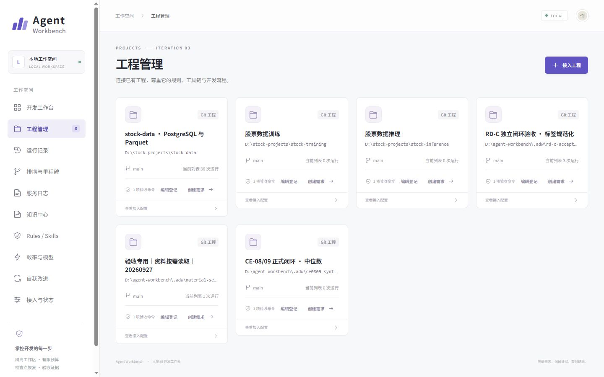
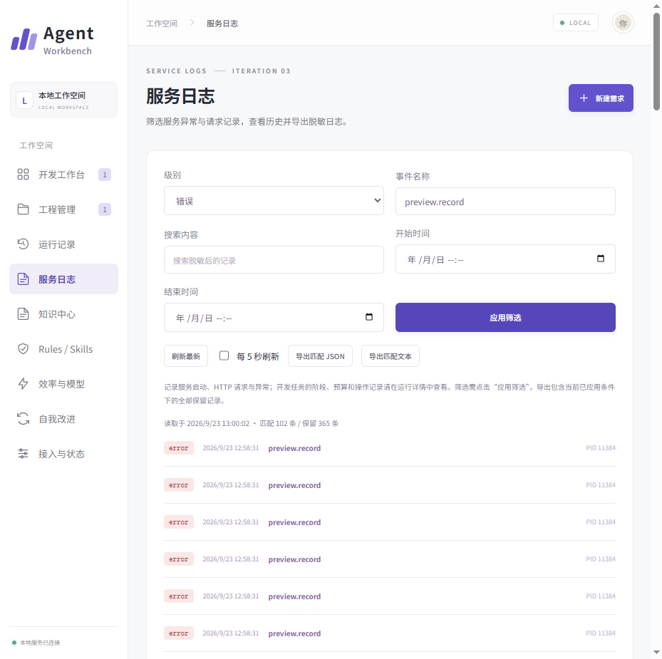
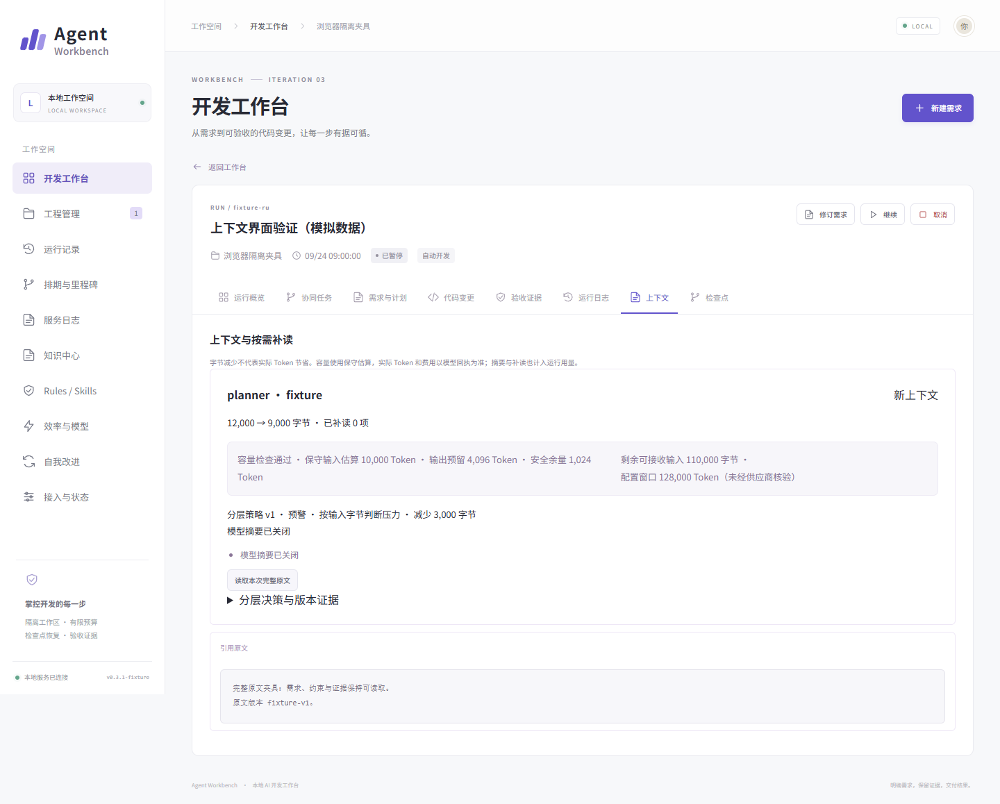
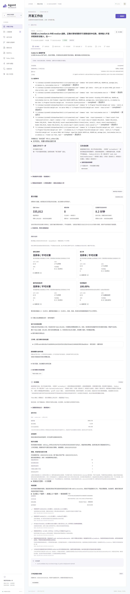

# Agent Workbench 截图导览

[项目介绍](项目介绍.md) · [流程图](流程图.md) · [项目总览](../README.md)

共 12 张历史截图。按功能展示，未重新启动工作台、调用模型或重跑业务任务。图片保持原始字节；各图的真实任务、正式服务读取、测试样例和模拟数据分别标注。

## 面试展示顺序

建议用约 3 分钟讲完主线：02 首页 → 03 工程接入 → 04 明确需求与授权 → 01 真实开发完成 → 06 保留自测证据。追问状态关联时看 05；追问可观察性、知识和上下文时看 07 至 11；12 为交付详情长图。

图 01、03、04、12 属于 CE-08/09 中位数案例；图 05、06 属于 CE-02/04/05 平均值案例。图 02、10 是更早的正式服务只读检查。不要把不同任务和版本叙述为同一次运行。

## 截图目录

| 编号 | 页面 | 面试时可以讲什么 |
| --- | --- | --- |
| 01 | [直接CLI开发完成历史页面](截图/01-直接CLI开发完成历史页面.png) | 执行状态与任务验收分开 |
| 02 | [工作台首页与运行总览](截图/02-工作台首页与运行总览.png) | 任务总览和工程入口 |
| 03 | [工程管理与接入列表](截图/03-工程管理与接入列表.png) | 接入已有 Git 工程与验收命令 |
| 04 | [需求方案与工作包确认](截图/04-需求方案与工作包确认.png) | 需求版本 工作包授权和冻结保护 |
| 05 | [需求讨论与同页开发进度](截图/05-需求讨论与同页开发进度.png) | 父讨论与后继开发任务关联 |
| 06 | [验收证据与失败记录保留](截图/06-验收证据与失败记录保留.png) | 失败保留 自测与独立验收分开 |
| 07 | [运行日志筛选与导出](截图/07-运行日志筛选与导出.png) | 业务事件筛选 固定序号与导出 |
| 08 | [服务日志与错误筛选](截图/08-服务日志与错误筛选.png) | 服务诊断与业务运行日志分开 |
| 09 | [知识中心与来源核对](截图/09-知识中心与来源核对.png) | 知识发布 版本和来源核对 |
| 10 | [上下文策略与模型角色配置](截图/10-上下文策略与模型角色配置.png) | 角色配置 上下文策略与容量估算 |
| 11 | [运行上下文与原文回读](截图/11-运行上下文与原文回读.png) | 完整原文保留和按需回读 |
| 12 | [开发完成与交付回执完整长图](截图/12-开发完成与交付回执完整长图.png) | 同一任务的完整交付回执 |

## 全部截图

### 01 直接CLI开发完成历史页面

**类型：历史实际完成页面截图。** CE-08/09 历史正式闭环。

讲述重点：执行状态与任务验收分开。

CE-08/09 的中位数函数修复案例。页面明确显示 Codex CLI 直接开发，按当前 Windows 账户运行、无执行隔离；CLI 自测与最终独立验收分开。只证明该限定案例。

### 02 工作台首页与运行总览

**类型：历史正式服务只读截图。** v0.3.1 2026-09-24 正式服务读取。

讲述重点：任务总览和工程入口。

展示工程入口、近期运行、完成状态与已知 Token。来源为 2026-09-24 正式 4310 服务的只读页面检查；图中工程数、运行数和配置就绪均为当时现场，不代表当前服务状态。

### 03 工程管理与接入列表

**类型：历史实际工程管理截图。** CE-08/09 工程登记现场。

讲述重点：接入已有 Git 工程与验收命令。

展示已接入的 Git 工程、目录、分支、验收命令和创建需求入口。该列表同时包含业务工程与验收专用工程，已登记工程不等于该工程全部业务功能完成。

### 04 需求方案与工作包确认

**类型：历史实际需求确认截图。** CE-08/09 真实中位数案例。

讲述重点：需求版本 工作包授权和冻结保护。

中位数修复案例的方案确认页。展示需求正文、冻结文件保护、验收条件、选中工作包及直接 CLI 模式。可用于说明明确授权如何进入开发；该入口没有 OS 执行隔离。

### 05 需求讨论与同页开发进度

**类型：历史实际关联任务截图。** CE-02/04/05 真实平均值案例。

讲述重点：父讨论与后继开发任务关联。

CE-02/04/05 的平均值函数案例，需求讨论页关联真实后继开发任务，展示方案与目标完成进度。该图与中位数案例来自不同任务，不能拼成同一次运行。

### 06 验收证据与失败记录保留

**类型：历史实际任务证据截图。** CE-02/04/05 真实任务证据。

讲述重点：失败保留 自测与独立验收分开。

平均值函数真实任务的验收证据标签。可见 CLI 自测的失败与成功回执均被保留，且明确标注非独立验收。最终独立命令与审查结论须结合原报告核对，不能把这些 CLI 回执当作独立放行。

### 07 运行日志筛选与导出

**类型：历史界面验收样例截图。** v0.3.1 S17 日志观察验收样例。

讲述重点：业务事件筛选 固定序号与导出。

使用日志界面验收样例展示 task.state 筛选、固定序号上限、历史读取与 JSON／文本导出。图中日志条数和事件来自样例，不代表真实模型调用规模或生产吞吐量。

### 08 服务日志与错误筛选

**类型：历史界面验收样例截图。** v0.3.1 S17 服务日志验收样例。

讲述重点：服务诊断与业务运行日志分开。

展示服务日志的级别、事件名称、关键词、时间筛选和脱敏导出。preview.record 错误行属于界面验收样例，用于展示诊断能力，不作为真实生产故障统计。

### 09 知识中心与来源核对

**类型：历史知识功能验收样例截图。** v0.3.1 S16 知识功能限定验收。

讲述重点：知识发布 版本和来源核对。

展示 Wiki 发布状态、来源核对与已发布知识检索。样例工程的 value 常量只是知识流程测试素材；原记录 liveModelCalls 为 0，不能宣称完成真实业务 RAG 效果评测。

### 10 上下文策略与模型角色配置

**类型：历史正式服务只读截图。** v0.3.1 2026-09-24 正式配置 v2。

讲述重点：角色配置 上下文策略与容量估算。

展示 L0-L3 上下文策略、整理阈值、模型角色与容量配置。来自正式服务只读检查；图中阈值与 120000 字节是旧配置，不代表当前默认值、供应商能力或已量化的成本收益。

### 11 运行上下文与原文回读

**类型：历史模拟数据界面截图。** v0.3.1 上下文界面隔离夹具。

讲述重点：完整原文保留和按需回读。

页面自身标注模拟数据，展示材料整理、容量估算与完整原文回读。字节减少不等于真实 Token 节省；图中窗口值未获供应商核验，不能作为实际模型效率结论。

### 12 开发完成与交付回执完整长图

**类型：历史实际任务完整页截图。** CE-08/09 同一完成任务完整页。

讲述重点：同一任务的完整交付回执。

与第 01 张为同一个中位数任务的完整页面，用于查看开发、自测、用量、验收及交付相关信息。长图作为追问时的补充材料，不另算一个成功案例，不据此推导整体自动化或效率收益。

来源文件、分辨率和 SHA-256 见总目录的 [素材清单](../素材清单.json)。文件修改时间不单独证明拍摄日期；历史页面中的就绪状态、价格、模型参数和数量不能解释为当前事实。
