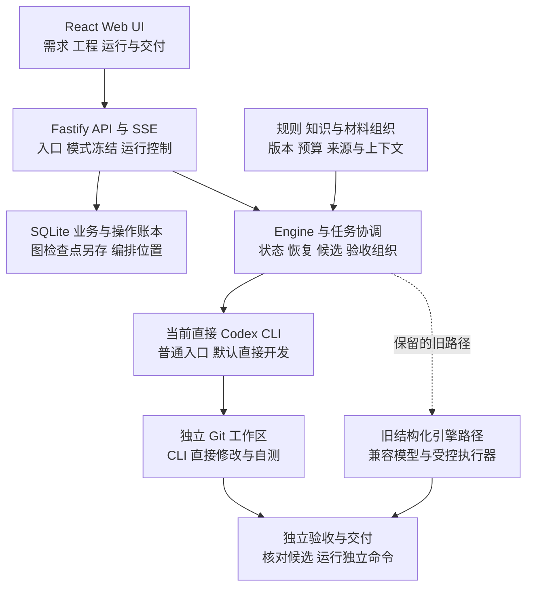
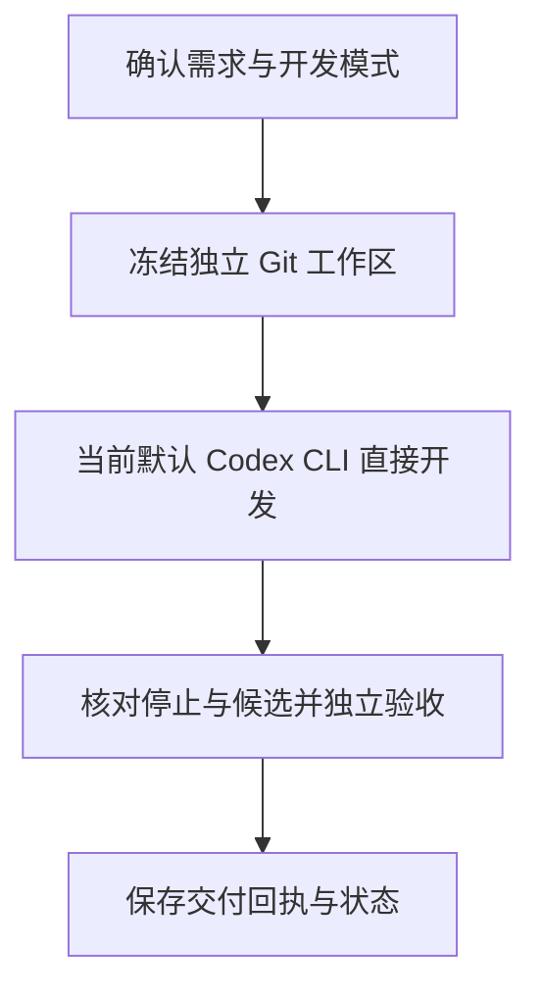
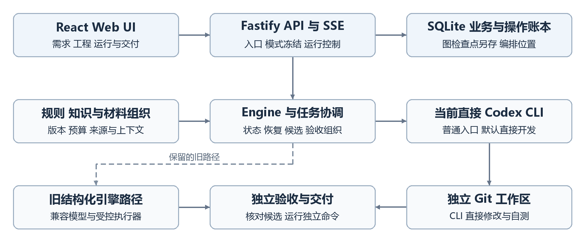

# Agent Workbench 流程图

## 当前系统架构

## 核心业务流程

## 图示说明

直接 CLI 无 OS 权限隔离  自测不等于独立验收  虚线为保留的结构化执行路径。

架构按 2026-10-22 本地源码及现有文档整理，箭头表示主要调用、数据或产物流向，不代表所有连接均已完成实机验收。

## 不支持 Mermaid 时查看

[返回项目介绍](项目介绍.md)
