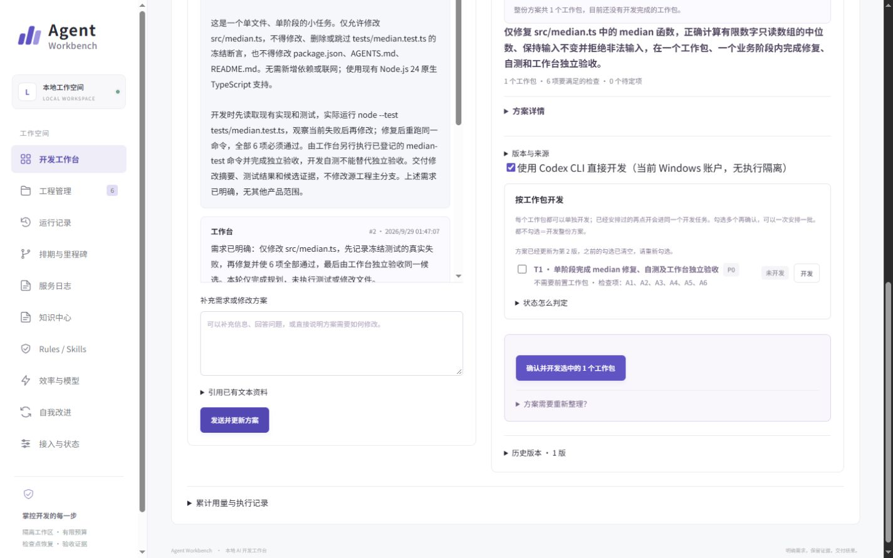
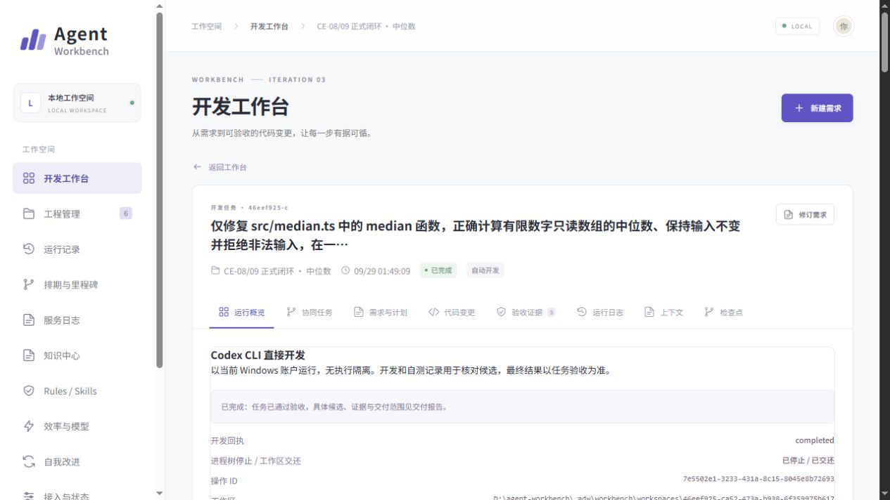
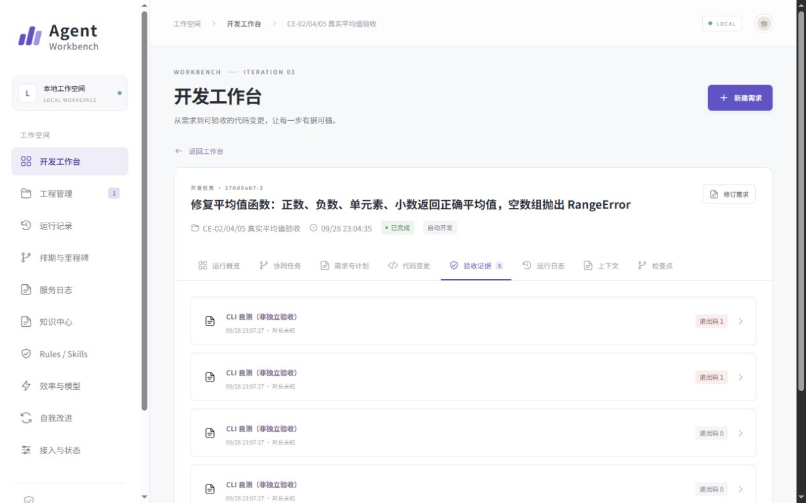

# Agent Workbench

Windows 本地可视化 AI 开发工作台

展示定位：可视化备选。整理日期：2026-10-22。

## 项目简介

Windows 本地 AI 开发工作台，通过浏览器管理需求、工程、运行和交付。当前普通入口默认使用 Codex CLI 直接开发；原有 LangGraph 结构化模型与受控执行链路继续保留。业务账本、操作回执和图检查点分别保存运行事实、执行结果与编排位置。

## 技术栈

React  TypeScript  Fastify  LangGraph  SQLite  Windows 原生宿主

## 架构与流程

[查看 Mermaid 架构图与流程图](流程图.md)

## 面试讲述

这个项目把需求、AI 开发和独立验收放到本地工作台管理。当前普通入口使用 Codex CLI 在独立 Git 工作区直接开发，完成后仍需核对候选、运行独立命令并验收。CLI 的自测不是最终验收；独立目录和 Git 也不代表操作系统权限隔离。旧的结构化执行模式仍保留。

## 可展开的技术设计

- 两种执行路径：当前直接 CLI 开发与原结构化引擎分别保留配置和证据，不能混写为同一权限边界。
- 恢复与交付：操作意图、回执和检查点分离；复核候选和停止事实后再推进，未知结果不盲目重派。

## 当前状态与实现边界

CE-08/09 记录了当前直接 CLI 普通入口及一个中位数函数修复的真实完成案例。该入口无 OS 执行隔离，独立验收仍保留；完整双任务故障恢复与长期运行不能据此宣布全部通过。

## 项目截图

已整理 12 张截图，覆盖总览、工程接入、需求确认、任务进度、证据、日志、知识和上下文。

[查看全部截图和建议讲述顺序](截图导览.md)。以下先展示首页、方案确认、开发结果和证据记录。

### 02-工作台首页与运行总览

**类型：历史正式服务只读截图。** v0.3.1 2026-09-24 正式服务读取。

展示工程入口、近期运行、完成状态与已知 Token。来源为 2026-09-24 正式 4310 服务的只读页面检查；图中工程数、运行数和配置就绪均为当时现场，不代表当前服务状态。

### 04-需求方案与工作包确认

**类型：历史实际需求确认截图。** CE-08/09 真实中位数案例。

中位数修复案例的方案确认页。展示需求正文、冻结文件保护、验收条件、选中工作包及直接 CLI 模式。可用于说明明确授权如何进入开发；该入口没有 OS 执行隔离。

### 01-直接CLI开发完成历史页面

**类型：历史实际完成页面截图。** CE-08/09 历史正式闭环。

CE-08/09 的中位数函数修复案例。页面明确显示 Codex CLI 直接开发，按当前 Windows 账户运行、无执行隔离；CLI 自测与最终独立验收分开。只证明该限定案例。

### 06-验收证据与失败记录保留

**类型：历史实际任务证据截图。** CE-02/04/05 真实任务证据。

平均值函数真实任务的验收证据标签。可见 CLI 自测的失败与成功回执均被保留，且明确标注非独立验收。最终独立命令与审查结论须结合原报告核对，不能把这些 CLI 回执当作独立放行。

## 依据与核对范围

以下为原项目仓库中的相对路径：

- `docs/evidence/ce-autonomy-20260929/ce08-09/README.md`
- `src/core/engine.ts`
- `docs/当前项目架构图.md`

本次核对源码与已有记录并整理展示材料；未重跑全量测试或正式业务验收。截图可证明其显示的页面或代码，不能独立证明全部功能就绪。

[返回项目总览](../README.md)
